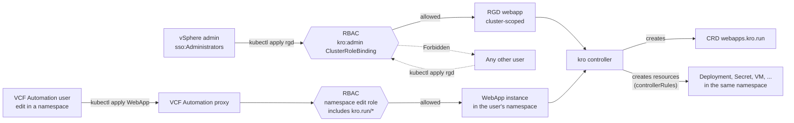
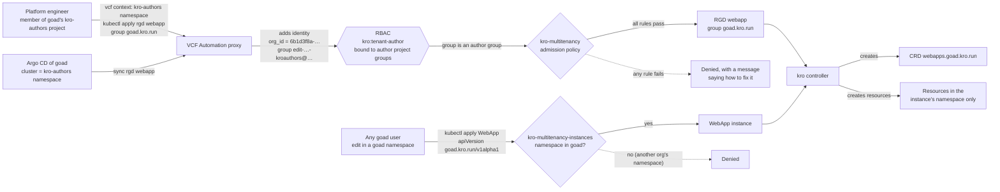
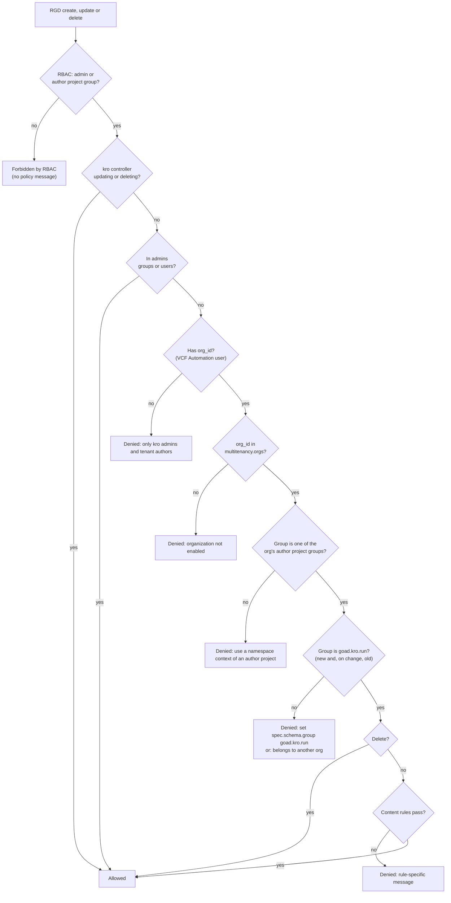

# Who can author ResourceGraphDefinitions

The service runs in one of two modes:

- **Admins only** (the default). Only the vSphere groups and users in `admins` create ResourceGraphDefinitions (RGDs). VCF Automation users create instances.
- **Multitenancy** (`multitenancy.enabled: true`). Platform teams in VCF Automation organizations also author RGDs, from kubectl or Argo CD, without being Supervisor admins. Each organization gets its own API group and stays inside guardrails.

Anyone with access to a namespace can create instances in both modes.

## Admins only

```yaml
admins:
  groups: [sso:Administrators@vsphere.local]
  users: []
multitenancy:
  enabled: false
```



- ClusterRole `kro:admin` (manage RGDs, read GraphRevisions) is bound to `admins.groups` and `admins.users`. Nothing is bound when both are empty.
- No admission policy runs.
- VCF Automation users can't create RGDs. Their RoleBindings are namespaced, and RGDs are cluster-scoped.
- Namespace users get `kro.run` instances through upstream's `kro-edit` and `kro-view` roles, which aggregate into `admin`, `edit` and `view`.

## Multitenancy

```yaml
admins:
  groups: [sso:Administrators@vsphere.local]
multitenancy:
  enabled: true
  oidcClientId: 4f2c9a1e-7b3d-4c8a-9e61-2d5b8f0a3c7e   # OIDC client of VCF Automation on this Supervisor
  orgs:                          # one entry per organization; each gets <name>.kro.run
  - name: goad
    id: 6b1d3f8a-2c4e-4a7b-8d9f-0e5c7a1b3d2f
    authorProjects:              # projects whose editors and admins author RGDs
    - name: kro-authors
      id: 9a7e5c3b-1d2f-4e6a-8b0c-4f3d2e1a0b9c
```

`oidcClientId` is required. The chart refuses to render without it. It is the same for every organization on the Supervisor.

`orgs[].id` is the UUID in the organization's URN (`urn:vcloud:org:<id>`). An author from an unlisted organization is refused with its ID in the message, so you can add it. The name `internal` is reserved: `internal.kro.run` belongs to kro.

`authorProjects` lists at least one project per organization. `id` is the Project's `metadata.uid`. Any project can be an author project, and an organization can have several.

### What VCF Automation tells the Supervisor

VCF Automation users reach the Supervisor through its proxy. The proxy replaces the user's groups and roles with a project group. Only these reach the Supervisor:

| Field | Example | Source |
|---|---|---|
| username | `alice@example.com` | the user |
| group | `edit-9a7e5c3b1d2f4e6a8b0c4f3d2e1a0b9c-kroauthors@4f2c9a1e7b3d4c8a9e612d5b8f0a3c7e.net` | the project of the namespace in the kubectl context. `edit` for the edit and admin roles, `view` for viewers |
| extra `vcf.vmware.com/org_id` | `6b1d3f8a-2c4e-4a7b-8d9f-0e5c7a1b3d2f` | the organization |
| extra `vcf.vmware.com/rights` | `can-edit-privileged-labels` | org admins only |

The group has this format:

```
edit-<project uid without hyphens>-<project name, shortened>@<OIDC client ID without hyphens>.net
```

- The project uid is the Project's `metadata.uid` with the hyphens removed. Projects are matched by uid, so two projects with similar names never get mixed up.
- The shortened name is the project name, lowercased, with every character that isn't a letter or digit removed, cut to 10 characters. `kro-authors` becomes `kroauthors`.
- The suffix is the client ID of the OIDC identity provider that VCF Automation registered on this Supervisor, without hyphens. It is the same for every organization. In vCenter, `GET /api/vcenter/namespace-management/supervisors/{supervisor}/identity/providers/{provider}` shows it as `client_ID`. The display name looks like `<client id>_<vcfa host>_refcount(1)`. `kubectl auth whoami` shows it after the `@` of the `edit-` group.

The chart builds the exact group for every author project from `oidcClientId` and the project `name` and `id`. `scripts/multitenancy-values.sh <namespace-context> <org-name> [project-name]` prints the values for one author project from `kubectl auth whoami`. The project name defaults to the last part of a vcf CLI context name.

Directory groups, org roles and project roles never reach the Supervisor. Author access therefore comes from project membership, which the proxy does send.

### Publishing an API



To set an organization up:

1. As an org admin in VCF Automation, create a project, with any name, and one Supervisor namespace in it. This is an author project. An organization can have several.
2. Give the platform team the `edit` or `admin` role on it, as users or as a VCF Automation group.
3. As a user with that role, run `scripts/multitenancy-values.sh <namespace context> goad`. Add the `oidcClientId` and the org with its `authorProjects` entry to the service values and update the service.
4. Authors switch to that namespace's context, `vcf context use <context>:<namespace>:<project>`, and apply RGDs with `spec.schema.group: goad.kro.run`.
5. For Argo CD, register the author project's namespace as a cluster and point an Application holding the RGDs at it. Argo CD reaches the Supervisor through the same proxy as the organization's service account, so the same rules apply.

Instances use `apiVersion: goad.kro.run/v1alpha1` and can be created in any goad namespace by its editors.

### How a write is decided



Reads go through the RBAC step only. The API group is the owner record. Only goad can create, change or delete RGDs in `goad.kro.run`. kro's CRD also makes `spec.schema.group` immutable, so an RGD can't be moved to another group, by an author or by an admin. kro keeps a deleted RGD's CRD and instances, and adopts them only for an RGD with the same name, kind and group, so no other organization can take them over. Kind names never collide between organizations: `webapps.goad.kro.run` and `webapps.acme.kro.run` coexist.

The kro controller is exempt only when it updates or deletes an RGD (finalizers, labels). An RGD created by the controller, which happens only when a template tries to make one, goes through the rules and is refused.

### Content rules

| Rule | Message when it fails |
|---|---|
| `spec.schema.group` is the organization's group | `Set spec.schema.group: goad.kro.run (your organization's API group).` |
| `spec.schema.scope` is `Namespaced` | `Tenant ResourceGraphDefinitions must create Namespaced instances (spec.schema.scope).` |
| Templates don't set `metadata.namespace` | `Resource templates may not set metadata.namespace. ...` |
| `externalRef` sets `metadata.name`, and not `metadata.namespace` or `metadata.selector` | `externalRef must name one object in the instance's namespace: ...` |
| Templates and references don't use RGDs, `internal.kro.run`, CRDs, RBAC or admission objects | `Tenant ResourceGraphDefinitions may not create or reference ...` |

kro can only create kinds its controller may touch: the service's default set (`defaultControllerRules`, all namespaced; see the README) plus anything the admin adds in `controllerRules`. Those permissions are one list for every organization and every namespace. Kubernetes RBAC can't say "only in goad's namespaces", so the content rules do that job: a tenant template has no namespace, and kro creates everything in the instance's namespace, which the instance's creator can already edit. That only works for namespaced kinds. In multitenancy mode, add only namespaced kinds to `controllerRules`; a cluster-scoped kind (Namespace, StorageClass, ClusterRole) would be created cluster-wide.

### What the chart renders

| Object | Purpose |
|---|---|
| ClusterRole and ClusterRoleBinding `kro:tenant-author` | RGD get, list, watch and writes, bound to the exact author group of every listed author project. The policy checks the same groups again and decides what they may write. |
| ClusterRoles `kro:tenant:<org>:edit` and `:view` | `<org>.kro.run` instances for namespace editors and viewers (aggregated into `edit`, `admin`, `view`). |
| ClusterRole `kro:tenant:<org>:controller` | Lets the kro controller manage `<org>.kro.run` instances (aggregated into its role). |
| ValidatingAdmissionPolicy `kro-multitenancy` | The author and content rules above. `failurePolicy: Fail`. |
| ValidatingAdmissionPolicy `kro-multitenancy-instances` | `<org>.kro.run` instances only in namespaces labeled `vmware-system-vcf/organization-id: <org id>`. `failurePolicy: Fail`. |

Both policies and their bindings carry the kapp change group `kro.field.vmware.com/multitenancy-policy`. The ClusterRoleBinding `kro:tenant-author` and the ClusterRoles `kro:tenant:<org>:edit` have change rules: they are upserted after that group and deleted before it. So the grants never exist without the policies, on install, upgrade or removal.

A user who is not an admin or an editor of an author project gets a plain RBAC `forbidden` error before the policy runs, so they don't see the policy messages.

## Who can do what

| Who | Create RGDs | Change or delete an RGD | Read RGDs | Create instances |
|---|---|---|---|---|
| **Admins only** | | | | |
| vSphere admin in `admins` | any | any | all | where they have edit |
| VCF Automation user | no | no | no | `kro.run` kinds in namespaces they edit |
| other vSphere users, ServiceAccounts | no | no | no | per their RBAC |
| **Multitenancy** | | | | |
| vSphere admin in `admins` | any | any | all | where they have edit |
| member of an author project of a listed org | in its org group, within the rules | its org's RGDs only | all orgs' | own org's and admin kinds, in namespaces they edit |
| other member of a listed org | no | no | no | own org's and admin kinds, in namespaces they edit |
| user of an unlisted org | no | no | no | admin kinds, in namespaces they edit |
| other vSphere users, ServiceAccounts | no | no | no | per their RBAC |

## Known limits of multitenancy

- Only admins and editors of author projects can read RGDs. Reads are not filtered per organization: authors of every listed organization can read every organization's RGDs, because admission policies see only writes.
- If VCF Automation registers the Supervisor again with a new OIDC client, or an author project is deleted and recreated (it gets a new uid), the author groups change. Authors are refused until the values are updated (it fails closed). `make smoke-test-multitenancy` catches this.
- Keep admin RGDs out of organization groups such as `goad.kro.run`, or that organization can change them.
- Isolation relies on the content rules and on `controllerRules` listing namespaced kinds only. kro v0.10 adds a namespaced `Graph` API that applies resources while impersonating a ServiceAccount in the namespace. Once it is stable, it could replace the content rules.
- The group format the proxy sends isn't documented by VMware. If a VCF Automation upgrade changes it, the author groups no longer match and everyone is refused (it fails closed). Re-test after VCF Automation upgrades.
